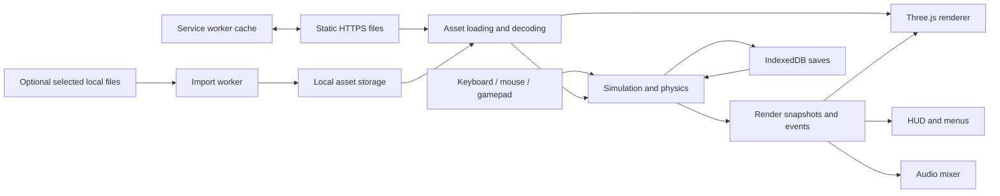

# San Andreas in the browser

For the accuracy-first execution order, asset compatibility gates and campaign decision, read the [fidelity blueprint](FIDELITY_BLUEPRINT.md) alongside this full design.

## Recommendation

Build a desktop-first, single-player 3D game using TypeScript, Vite, Three.js, and Rapier, delivered as static files. Put the entire simulation, mission system, audio, world streaming, and saves on the player's device. Start with a small, carefully reconstructed Los Santos district and make walking, cycling, stealing a car, driving, fighting, police response, and saving work together before expanding the map.

The most important investment is a **reference-driven content and behavior pipeline**. A generic city with a third-person controller will not become an accurate San Andreas recreation through extra effects. Street geometry, protagonist motion, camera framing, vehicle response, environmental color, traffic behavior, radio, and mission pacing must be designed and verified together.

The recommended content architecture supports two independent packs: newly authored or licensed content for a distributable build, and an optional importer for compatible files that players select locally. The importer is the strongest technical route to exact geometry and animation when appropriate assets are available, but it does not supply the missing gameplay implementation. Exact characters, dialogue, and soundtrack remain dependent on authorized content.

This is a proposed implementation design. Browser and library capabilities are sourced below. Budgets, schedules, subsystem choices, and acceptance thresholds are engineering judgments that require prototyping. No original game session or candidate browser engine was benchmarked for this report.

## 1. Fidelity target

Target original PC 1.0 for behavior, controls and presentation, as selected by the user on September 17, 2026. This supersedes the earlier PS2-era presentation target. Pin the executable identity, region, display mode, graphics settings, frame limiter and capture configuration before approving fidelity measurements. Existing PS2-inspired choices require PC-reference validation.

Rockstar's PC manual documents separate foot and vehicle controls, camera switching, radar and HUD options, radio behavior, and a default frame limiter described as 30 fps. That is evidence about presentation and controls, not proof of a particular internal physics tick rate.[^1]

Accuracy has several independent dimensions:

| Dimension | What success means | First evidence to collect |
|---|---|---|
| World | Correct street shapes, building masses, elevations, landmarks, distances, and sightlines | Matched camera locations and timed travel routes |
| Character | Recognizable silhouette, gait, acceleration, turning, jump and landing cadence, animation transitions | Side and rear movement captures at fixed stats |
| Vehicles | Correct class differences, suspension feel, steering, grip, braking, damage, entry and exit | Repeated straight-line, circle, slalom, curb, and collision trials |
| Camera | Matching offsets, smoothing, recentering, aiming, collision response, and chase behavior | Input-to-camera traces and synchronized clips |
| World behavior | Appropriate traffic, pedestrians, gang presence, reactions, and police pressure | Repeatable incident scenarios |
| Presentation | Era-specific lighting, weather, texture character, HUD placement, sound mix, and radio continuity | Day/night/weather captures and listening comparisons |
| Content | Faithful missions, progression, activities, interiors, characters, and dialogue | A versioned content inventory with completion evidence |

Prioritize the first four dimensions during the first playable build. Do not average a broken camera or inaccurate driving out of a score by adding more buildings. Maintain separate status for **implemented**, **tested**, and **reference-validated**.

For differences that improve browser usability, expose named options: modern keyboard mapping, enhanced resolution, subtitles, camera shake reduction, and recovery saves. Keep reference behavior selectable where those options change gameplay or presentation. A crisp 1080p presentation can preserve the art direction without claiming pixel identity with a console signal.

## 2. Scope and player experience

The core loop is: explore the neighborhood, acquire transport or equipment, take a mission or activity, navigate a systemic encounter, gain money or progression, and return to a safe place. Free roaming must remain engaging between authored missions. Failure leads to mission failure, death recovery, arrest recovery, or a deliberate reload, with costs and inventory behavior defined by the selected reference.

Design the first vertical slice for a satisfying 15–25 minute session. This is a production target, not an original game statistic. It should contain a short mission chain and enough systemic interactions for the player to make their own detours.

| System family | First vertical slice | Later parity work |
|---|---|---|
| World | Grove Street/Ganton-scale area, nearby streets, an arterial road, alley, hill, and one interior | Full Los Santos, countryside, San Fierro, desert, Las Venturas, separate interiors and regional unlocks |
| On foot | Walk, run, sprint, jump, crouch, basic climb, hit reactions, death | Swimming, diving, broader climbing, fighting styles, equipment-specific actions |
| Transport | Bicycle, ordinary sedan, contrasting car, police car; usable seats and doors | Motorcycles, boats, aircraft, helicopters, trains, trailers, special and remote-control vehicles, jetpack and parachute |
| Combat | Unarmed, pistol, one automatic weapon; aiming, ammunition, reload, damage | Full weapon and skill inventory, explosives, scoped weapons, drive-by variants, specialist interactions |
| Population | Regional pedestrians, lane-following traffic, fleeing, retaliation, small gang encounter | Wider population tables, group recruitment, ambient behaviors and region-dependent responses |
| Police | Calibrated low-level pursuit and arrest/death recovery | Full six-star escalation inventory, vehicles, units, roadblocks and reference-specific clearing rules |
| Missions | Three short missions with cinematics, prerequisites, failure and retry | Full story graph, unique mission mechanics, cutscenes, localization and dialogue |
| Progression | Money, health, armor, basic stamina, one shop, safehouse and garage | Respect, body composition, skills, clothing, hair, tattoos, properties and gang territories |
| Activities | One repeatable driving activity | Schools, races, service jobs, burglary, gyms, food, gambling, pool, basketball, rhythm activities, dating and collectibles |
| Presentation | Day/night/weather sample, radar, status HUD, radio and ambient mix | All regional palettes, stations, audio events, maps, effects and menus |
| Platform-specific content | Single-player desktop | Inventory original PS2 local two-player activities separately if strict PS2 content parity is retained |

This is a coverage checklist, not a verified census of every mission, vehicle, animation, or side activity. The full-content inventory must enumerate them against a chosen release before any claim of full parity. The final world should preserve reference proportions; the initial district is a contiguous subset rather than a compressed miniature of the entire state.

## 3. Engine and reuse decisions

Three.js is the best fit for this empty, browser-focused workspace because it allows direct control over material behavior, streaming, camera, and simulation integration. It is a rendering foundation, so the design explicitly includes the game systems and tools that a larger engine might provide.

| Candidate | Strength for this project | Material cost or uncertainty | Decision |
|---|---|---|---|
| Three.js + Rapier | Direct rendering control, portable TypeScript, specialized vehicle and streaming code | Must implement mission, animation, population and content tooling | Recommended |
| Babylon.js + Havok | More integrated game-engine features, including physics and character support | Still needs San Andreas-specific behavior and content conversion | Strong alternative if editor/debug tooling proves more valuable than renderer control[^2] |
| PlayCanvas | Browser-oriented engine, authoring workflow, downloadable static builds | Workflow differs from a repository-first toolchain | Strong alternative for an editor-led content team[^3] |
| Godot web export | Integrated scene and animation authoring | Current stable docs constrain web rendering to Compatibility/WebGL2 and describe web-specific export limitations | Consider if the team is already productive in Godot; no reason to migrate solely for this project[^4] |
| React Three Fiber | Useful integration with a React application | This game has no existing React host; adds another lifecycle to coordinate | Use React for future tools if helpful; do not require it in the live simulation |
| Existing native code via WebAssembly | Potential behavior reuse when a complete, portable engine is available | Native platform assumptions and incomplete implementations are major work | A separate feasibility track, not the baseline |

Current Three.js documentation says `WebGLRenderer` uses WebGL2. Its `WebGPURenderer` selects WebGPU where supported and can fall back to WebGL2.[^5][^6] Start with **WebGLRenderer/WebGL2** for the reference renderer. Test WebGPU against the same scene later if profiling identifies a reason to change. Backend fallback does not automatically guarantee compatibility for arbitrary custom shader or post-processing code.

Do not choose WebGPU solely because it sounds higher quality. Original-era geometry and shading can be represented with WebGL2; renderer selection will not create accurate animation or vehicle dynamics. Keep the renderer behind an adapter, but maintain one production material pipeline until a second backend passes image comparisons and hardware tests.

### Existing projects

`gta-reversed` is relevant implementation research, but its current README describes a DLL injected into the native game and a future standalone executable goal. Its progress estimate is explicitly informal. It is not evidence of a complete San Andreas codebase that can simply be compiled to WebAssembly.[^7]

`librw` reimplements RenderWare graphics and documents DFF/TXD support with platform-specific limitations. It may help explain formats and material conventions; it does not provide missions or the complete game.[^8] DragonFF is a relevant Blender importer/exporter, with some map support described as partial or experimental.[^9]

Sketchbook demonstrates third-person and vehicle systems using Three.js and Cannon.js, but is archived. It is a useful reference rather than an actively maintained production foundation.[^10]

OpenSA is an unusually relevant search lead: indexed repository material describes a browser engine compatible with San Andreas files and identifies an AGPL license. However, direct repository, raw-file, and GitHub API requests returned 404 during verification. Neither present availability nor gameplay completeness was established. Do not make the architecture depend on it, and do not repeat its performance claims as measured evidence.[^11]

A candidate can replace the baseline only after a reproducible build demonstrates the required asset path, animated character, vehicle transitions, streaming, save behavior and target hardware performance, with a usable license. A rendered map or a video is insufficient.

## 4. No-backend architecture

The deployment consists of HTML, JavaScript, WebAssembly, fonts, shaders, audio and content packs on static HTTPS hosting. A static origin or CDN serves files; no gameplay API, account service, database server, cloud simulation, or runtime AI service is required. Authoring tools run locally or during a build and do not become a production backend.

Simulation owns entity IDs, health, inventories, vehicles, AI, mission state, timers, progression, and saveable world changes. Rendering owns meshes, textures, animation playback and visual interpolation. Camera composition belongs to presentation; gameplay queries used by the camera use a defined collision interface. Menus send commands rather than modifying meshes to change game state.

Begin with fixed-step simulation on the main thread and heavy asset processing in workers. Keep simulation interfaces worker-compatible from the beginning. Move simulation and Rapier together to one dedicated worker if representative profiling shows a main-thread bottleneck; do not split physics and rules across competing owners. Main-thread camera and audio consume snapshots and reliable state-change events.

The default worker transport uses pooled, transferable buffers and sequence numbers. A SharedArrayBuffer path is optional because shared memory requires secure context and cross-origin isolation. Ordinary workers do not require that deployment arrangement.[^12] If enabled, configure isolation headers on the static host and test every asset's origin policy. Emscripten pthreads introduce related deployment constraints; a native port does not remove them.[^13]

The game pauses simulation when hidden or explicitly paused, resets its timing accumulator on resume, and releases held input. Browsers throttle background work, so inactive-tab time cannot be treated as missed gameplay frames.[^14] A service worker manages asset caching and updates; it never owns a continuously running game loop.[^15]

## 5. Simulation and world state

Use a fixed timestep with explicit input actions and interpolate presentation between simulation states. Start by testing 60 Hz physics, while measuring behavior against the chosen original reference. A 30 Hz compatibility experiment should remain possible if reference behavior cannot be reproduced at 60 Hz through correct parameterization. Do not infer the original simulation frequency from its frame limiter.

Limit catch-up work and retain headroom to avoid an escalating backlog. Rendering at a different rate must not change vehicle acceleration, stamina depletion, weapon rate, or mission timers. The fixed-step approach and backlog hazard are well explained by Glenn Fiedler.[^16] A fixed timestep alone does not establish bitwise determinism across browsers or future engine versions.

Use a small component-based entity model with typed arrays for dense transforms and velocities, stable generational IDs, and ordinary serializable records for sparse mission and progression state. Avoid a complex entity framework before profiling demonstrates a need. Entity handles must become invalid when recycled so stale mission references cannot affect newly spawned traffic.

Run physically active bodies each physics tick. As proposed starting schedules, update nearby tactical decisions at 10–15 Hz, ambient decisions at 2–5 Hz, and distant population budgets at about 1 Hz. These schedules apply to decisions, not visible movement. Preserve mission-critical behavior irrespective of distance. Random generators are seeded per subsystem and checkpointed for reproducible tests within a pinned build.

Keep immutable world definitions separate from saved changes: garage contents, mission flags, collected items, territory ownership, purchased assets, and important persistent vehicles. Ordinary traffic is transient. Each mission owns its spawned actors and cleanup responsibilities; it can pin a sector and reserve population capacity until its references are released.

## 6. World construction and streaming

Create a topological map skeleton before dressing streets: road centerlines, widths, lane directions, junctions, elevation profiles, sidewalks, buildings, navigable passages and district boundaries. Hand-author landmarks and street composition against references. Procedural tools may scatter approved props and population, but should not invent the geography when accuracy is the goal.

Use independently loadable cells, initially around 128–256 meters per side, then tune granularity using actual content. Split a cell into render clusters, collision data, navigation, road graph, population rules and ambience. Large landmarks may span cells through shared resources and bounds references; never assume their pivots fall inside every cell they overlap.

| Residency class | Proposed first tuning range | Responsibilities |
|---|---|---|
| Interaction | Roughly 100–150 m around player and key actors | Detailed collisions, full nearby AI, vehicle interaction, high-detail characters |
| Approaching | Roughly 300–500 m with directional lookahead | Road and collision readiness, simplified population, near/mid visual LOD |
| Visible distance | Roughly 0.5–2 km as hardware permits | Coarse scenery, silhouette landmarks, atmospheric depth |
| Unloaded | Beyond relevance and pinning | Definitions and persistent deltas only |

These distances are engineering proposals, not recovered original values. Flight and high-speed travel require separate lookahead rules and must be profiled before aircraft are released.

Order streaming by time to interaction, visibility, mission relevance and resident memory. Prefetch along the predicted route, including plausible junction branches. A useful lower bound is `lookahead distance >= speed × worst-case readiness time + stopping margin`; at 40 m/s and a measured 2-second readiness time, travel alone needs 80 m of lead. Use measured tail latency, not average network time.

Collision readiness is a hard dependency for entry into a sector. Preload before visible entry; if loading cannot keep up, hold at the last safe simulation state and show a brief loading transition rather than let a vehicle fall through missing ground. Teleports and interior changes preload their destination. Protect active contacts, mission actors and the player's current vehicle from eviction.

Preserve transforms and velocities when promoting lane-driven traffic into rigid-body simulation. Use hysteresis when changing population and visual detail so entities do not oscillate between modes. Spawn outside view where possible; retire entities only after visibility, interaction and mission checks. LOD transitions must preserve silhouettes and materially important road geometry.

Use geometry instancing for repeated vegetation and props, and spatially bounded material batching for static environment meshes. Do not merge an entire city into one mesh: it harms culling and streaming. Bake pedestrian navmesh tiles during authoring and load them with their sectors. Recast Navigation's JavaScript/WASM bindings support tiled navigation and worker-based generation workflows, but they do not provide a ready-made streamed-city manager.[^17] Road traffic follows a dedicated lane graph, not the pedestrian navmesh.

## 7. Art and asset pipeline

The visual target is the original-era composition: readable silhouettes, period clothing and vehicles, texture-based surface detail, regional color and haze, strong sky mood, and a limited lighting vocabulary. Increase resolution carefully; oversized normal maps, glossy asphalt everywhere, aggressive bloom and physically elaborate reflections can move the result away from the reference.

For original content, use Blender source files, a consistent skeleton family, and explicit exports. Ship GLB/glTF 2.0 with Meshopt-compressed geometry and KTX2/Basis textures where they pass comparison tests. glTF Transform supplies inspection, pruning, deduplication, simplification and compression tools; inspect after each destructive optimization.[^18] KTX2Loader transcodes supported Basis textures into a GPU format suitable for the device.[^19]

Use meters, Y-up, and a documented local forward axis. Any importer must apply a tested basis transform to geometry, normals, winding, animation, collision and spawn data together. Never correct inconsistent axes individually at runtime. Vehicles need stable wheel, seat, door, light, exhaust, damage and camera attachment points. Characters need named bones, contact events and motion metadata.

Treat legacy material information as first-class data. Preserve vertex colors, day/night color information where present, alpha cutouts, texture addressing, UV animation and reflection intent. Standard glTF export alone may discard these semantics; use documented custom attributes and material metadata. Do not automatically replace a prelit material with modern PBR and expect it to match. DragonFF's documented features include night vertex color and several Rockstar material extensions, which makes round-trip inspection important.[^9]

Every asset manifest entry records stable ID, content hash, source and permission metadata, bounds, LODs, expected materials, collision reference, memory estimate and interaction anchors. Art checks validate animated poses, vehicle entry alignment, scale, collision matching, night appearance and far silhouettes. Automated checks catch broken files; artists approve visual identity.

### Optional original-file import

Keep this as a separable feature behind a `ContentProvider` interface. The player explicitly selects supported files; parsing and caching happen locally without upload. A compatible asset pack can then share the same world, animation and interaction contracts as newly authored content. Restrict the first importer to one documented source build; do not promise support for every console, PC, mobile and Definitive Edition layout.

The format inventory to investigate includes IMG archives; IDE definitions and IPL placements; DFF models; TXD textures; COL collision; IFP animation; handling, weapon, population, path and time-of-day data; plus separately scoped text, scripts and audio containers. Model conversion is only one part. A complete mission-script interpreter is a separate major program and is not required for a newly authored mission system.

Begin with the first district, one pedestrian rig and one vehicle. Validate material fidelity, skinned poses, pivot alignment and collision before importing more. Process bounded chunks, validate offsets and lengths, support cancellation, and cache by source hash plus converter version. Local file selection should have a standard file-input path; richer directory-picker support is an enhancement after compatibility testing.

For imported geometry, avoid doing expensive lossy recompression on every first launch. Preserve compatible source texture compression where practical and cache converted results. Any fallback to decoded RGBA must be accounted for in memory budgets. Locally imported content is never accidentally added to the public distribution bundle. An imported PC content pack with PS2-style rendering is a hybrid until specifically validated against PS2 references.

## 8. Character, animation and camera

Use a kinematic capsule controller with explicit grounded, airborne, climbing, swimming, vehicle-transition and incapacitated states. Rapier provides movement correction, slope handling, autostep and ground-snap facilities; it does not implement San Andreas locomotion or animation.[^20] Tune the controller against reference runs, including curbs, stairs, downhill turns, low ceilings, moving vehicles and uneven sidewalks.

The animation graph needs locomotion blending, weapon-dependent upper-body layers, turns, stops, jumps, landings, hits and synchronized interactions. Simulation determines action phase and gameplay events; rendered animation follows that authoritative phase. Do not make a weapon fire or a car seat change depend on a render-only animation callback that could be skipped at low frame rates.

Use controller-driven displacement for ordinary movement and constrained root-motion segments for authored interactions where they improve alignment. Reconcile root motion through collision. Preserve the original motion's timing rather than assembling a collection of unrelated generic animation clips. Foot placement and hand alignment are useful correction layers, but must not erase the reference posture.

Vehicle entry is a coordinated state machine: choose reachable door and seat, reserve them, approach, align, open door, displace an occupant if applicable, animate entry, transfer control and close the door. Define interruption behavior for collisions, moving vehicles, blocked doors, death and competing entrants. Exiting checks a safe capsule position and inherits appropriate vehicle velocity. These transitions are disproportionately important to perceived quality.

Implement distinct camera modes for on-foot follow, aiming, vehicle chase, reverse/look-back, swimming, cinematics and special vehicles. Each has its own target offset, lag, recenter delay, pitch limits and field-of-view policy. Sweep a volume between target and camera to avoid wall clipping; a single narrow ray often misses edges. Restore distance smoothly when obstruction clears.

Calibrate camera and character together. A correct running speed viewed through the wrong field of view feels wrong. Capture reference aspect ratio and distinguish horizontal from vertical FOV before measuring. Avoid adding modern shoulder swaps, cover systems, heavy camera shake or automatic cinematic angles unless the chosen reference calls for them.

## 9. Vehicles and physical interactions

Use dynamic chassis bodies with compound convex collision proxies. Begin with Rapier's raycast vehicle controller as an integration tool. Its API covers suspension, engine force, braking and wheel parameters.[^21] Build an explicit handling layer around those facilities; the default controller is not a San Andreas handling model.

Each vehicle definition needs mass distribution, center of mass, wheelbase, track width, suspension travel, spring/damping behavior, torque response, gear behavior, braking distribution, steering rate and speed sensitivity, grip characteristics, aerodynamic resistance and damage response. Preserve source units and conversion rules if importing handling data; source parameters are not necessarily directly usable SI coefficients.

Tune in this order: straight-line response, braking, steady turn, transient steering, suspension, traction loss, collision response, then special behavior. Record speed-over-time curves, stopping distance, turn radius, roll, pitch and landing recovery under identical conditions. Compare several representative vehicle classes early so a single universal handling preset cannot disguise missing behavior.

The proposed tire layer models longitudinal and lateral response with saturation and load dependence, then applies intentionally arcade-oriented corrections only when reference evidence supports them. If a raycast tire cannot reproduce necessary curb or obstacle interactions, evaluate shape casts or a custom wheel-contact layer. Keep the physics interface replaceable so fixing handling does not require replacing world or mission systems.

Bicycles and motorcycles require lean, balance assistance, rider pose and distinct controls; they cannot be treated as narrow four-wheel cars. Watercraft need buoyancy and water drag. Aircraft and helicopters require separate control and force models. Trains and trailers require their own constrained-motion behavior. These enter production only after the common state, collision and streaming contracts are stable.

Damage should affect both feedback and behavior: panel states, doors, lights, tire effects, smoke, fire, and destruction where required. Prefer authored damage states and limited deformation to an expensive general destruction simulation. Use continuous collision detection selectively for fast critical bodies and swept queries for relevant projectiles; verify thin barriers and high-speed contacts.

## 10. Population, gangs, police and combat

Traffic uses a directed lane graph with speed profiles, junction connections, signal phases, yielding, following distance, lane changes and stuck recovery. Distant traffic can follow a kinematic route; vehicles near the player are promoted to physical simulation before contact. The transfer must preserve velocity, heading and route intent. Do not steer every car directly toward its final destination.

Pedestrians use local navigation corridors and small task stacks: wander, wait, converse, observe, flee, retaliate, enter a car, follow or perform a mission action. Population tables vary by district, time, weather and story context. Bodies, props and crowds receive bounded lifetimes and memory budgets, while critical actors retain identity and state.

Police response is an explicit compatibility subsystem. Track incidents, wanted level, eligible responders, spawn constraints, pursuit tasks, mission overrides, and level-reduction rules. Separate the visual stars from internal response state. Measure when the reference detects incidents and changes pursuit rather than inventing a modern witness/search-area model. Implementing GTA V-style search logic would be a design change, even if it seems more sophisticated.

For each escalation tier, capture unit composition, response delay, spawn distance, chase aggression and relevant escape conditions. Roadblocks and aerial responders must obey streaming readiness. Cap ambient traffic before denying a mission-required police vehicle. Test whether repainting, pickups, entering interiors, death, arrest, and mission scripts alter wanted state in the selected release.

Combat separates targeting, weapon simulation, damage and presentation. Provide distinct PC free-aim and controller targeting presets where required. A weapon definition specifies cadence, ammunition, reload phase, accuracy/spread, movement restrictions, skill modifiers, hit behavior and effects. Ordinary firearm hit queries may use hitscan; physical projectiles use dedicated simulation and swept collision.

Resolve camera aim into a target, then verify the path from the muzzle so weapons cannot shoot through nearby walls. Match target acquisition and hit reactions before adding elaborate effects. Melee needs animation phases and spatial hit volumes with a single application per target per swing. Group recruitment, gang relationships, territory triggers and mission hostility overrides live in simulation data.

## 11. Mission and progression architecture

Represent missions as data-driven state graphs with typed conditions and commands. Useful primitives include reach region, enter vehicle, escort actor, chase target, survive timer, defeat group, deliver item, play conversation, play cutscene, award progression and cleanup. A node waits on simulation events or predicates and declares success, failure, timeout and interruption paths.

Validate graphs for missing assets, unreachable states, unbounded waits, unavailable spawn positions and absent cleanup. Each mission reserves actors and sectors before it starts. Cancellation, failure, retry, death, arrest and skip-cutscene paths must all release reservations. Rewards use a transaction key so reloading or duplicate events cannot award money twice.

The first three missions should exercise different systems: a bicycle return journey, an errand involving shops and a short confrontation, and a driving escape followed by safehouse recovery. These are design test scenarios, not claims that the original campaign has been recreated. Exact mission reconstruction adds reference dialogue, staging, timing and outcomes after the underlying primitives work.

Cutscenes use authored tracks for actor motion, camera, dialogue, props and visibility. Skipping applies the same final state as normal completion. Narrative and actor transforms must never be driven solely by wall-clock timers. Preload the scene's content before entering the cinematic and restore input and camera ownership afterward.

Progression is data-driven: player stats, money, weapons, appearance, property ownership, garage contents, collectibles, territory, mission completion and regional access. Save only meaningful world changes. Body composition and clothing need a compatible character-art plan; adding a stat slider without visible and behavioral consequences is not parity.

Side activities share the mission framework where appropriate, with specialized mechanics for rhythm, billiards, gambling and sports. A legacy SCM-compatible interpreter, if later desired, must explicitly support opcode semantics, script scheduling, native commands and saved script state. Reading a script file is not equivalent to executing the original campaign correctly.

## 12. Rendering, audio and interface

Build a material and lighting reference scene containing the protagonist, cars, road, vegetation, a building facade and a reflective surface. Match it in clear daylight, sunset, night and rain before dressing the full district. Use regional time/weather tables to drive sky, fog, sun/ambient balance and color grading. Preserve source vertex lighting if available, and avoid applying baked illumination twice.

Use a limited moving shadow solution around important actors, with inexpensive contact shadows as appropriate. Night lighting can combine emissive windows, light coronas, prelit environment data and a small set of dynamic lights. Water begins with controllable color, surface motion and reflection cues; expensive screen-space effects are optional. Keep smoke, dust, tire marks, muzzle flashes, weather and explosion effects within explicit particle and decal pools.

Audio needs separate buses for dialogue, radio, engines, weapons, ambience and UI. Use short decoded buffers for precise effects and media-element streaming for long music tracks, consistent with browser audio guidance.[^22] Maintain a radio station timeline and state across vehicle changes according to the reference rather than restarting a song on every entry. Use engine load and speed to drive layered loops, plus tire slip, collision and surface sounds.

Begin audio from a deliberate play/resume gesture and handle rejection or suspension. Autoplay rules apply to Web Audio as well as media elements.[^23] Include subtitles and independent radio, dialogue and effects controls. Do not substitute public streaming-service embeds for the soundtrack; they would introduce external dependencies and different playback behavior.

The normal HUD preserves the recognizable layout: compact status information near the top right, circular radar near the lower left, transient objective text and event messages, and otherwise a clear playfield. Exact artwork and typeface depend on the content pack. Use a small canvas for the radar if convenient, with DOM/CSS for text, bars and menus. Radar coordinates must come from the same world transform as navigation.

Pause, map, stats, controls, graphics, audio, save and content management occupy separate modal screens. Pointer lock is requested from a user gesture, released for menus, and explicitly reacquired on resume. Handle denial and lock-loss events rather than assuming success.[^24] Keyboard mappings are remappable; original PC and modern presets remain separate. Gamepad disconnect, focus loss and simultaneous inputs have defined behavior. Touch support is a later control design and performance tier, not a resized desktop HUD.

## 13. Saving, offline use and updates

Use IndexedDB transactions for settings, save slots, schema versions and recovery records. Use OPFS for optional imported or converted binary assets where available, with a fallback cache implementation. OPFS supports worker-oriented file access but remains subject to origin storage limits and site-data deletion.[^25] Downloaded public content uses Cache Storage. Avoid storing duplicate copies in both systems without a deliberate reason.

A save includes content-pack identity, schema and engine version, player and progression state, mission checkpoint state, important entity records, persistent world deltas, clock/weather state and relevant random seeds. Reconstruct renderer and physics objects from that data; do not persist Three.js object graphs. Associate saves with compatible content manifests and provide migrations or a clear compatibility explanation.

Use a current slot and previous-good revision committed transactionally. Capture a stable simulation checkpoint, serialize asynchronously, then commit. Export/import a portable save file, including integrity and schema validation. Local storage can be evicted, persistence requests may be denied, and private browsing has different retention behavior; browser storage cannot be the only user-accessible backup.[^26]

Faithful manual saves and optional crash-recovery checkpoints are separate policies. Do not silently add advantageous mid-mission checkpoints when claiming original difficulty. A recovery restore must not duplicate money, reverse committed purchases or resurrect retired mission actors inconsistently.

Offline mode becomes available only after its complete manifest and content pack are verified on-device. Show which regions and audio packs are available offline. A partially cached world cannot promise unrestricted offline travel. Content downloads are resumable by independent hashed chunks; incomplete versions never replace a working pack.

Cache hashed assets immutably; revalidate the small release manifest. Stage new service-worker and content versions, then activate between sessions or after a save. Keep referenced older content until migration succeeds. Serve WebAssembly with its correct MIME type and test the actual production host. A normal static web application is launched from HTTPS or a local development server; double-clicking an HTML file is not the target distribution method.

## 14. Performance targets and device tiers

Choose actual reference machines before accepting performance. The suggested primary tier is a recent integrated-GPU laptop and a mainstream gaming PC at 1080p. Verify Chrome/Edge, Firefox and Safari on supported operating systems with real GPU acceleration. A lower tier can use 720p and 30 fps. Mobile support remains uncommitted until a representative district survives sustained device tests.

| Measure | Proposed vertical-slice target | Interpretation |
|---|---|---|
| Normal play | 60 fps; p95 frame interval at most 20 ms, p99 at most 33 ms | Warm, scripted traversal on named hardware; inspect distribution and input response |
| Lower tier | Stable 30 fps at reduced resolution and detail | Same gameplay rules and compatible saves |
| CPU work | Aim below 8 ms per 60 Hz tick/frame critical path | Measure threads individually and their dependency chain |
| GPU work | Aim below 10 ms for normal frames | CPU/GPU work overlaps; these are not additive guaranteed timings |
| Visible geometry | Start around 0.5–1.5 million triangles | Includes effects and shadows when counting rendered work |
| Draw calls | Start below roughly 400 including extra passes | An alert threshold, not a universal GPU limit |
| Population fixture | About 24 active vehicles and 48 visible pedestrians | A benchmark scene, not a claim about original limits |
| Resident game memory | Plan for roughly 400–700 MiB combined resource footprint | JS, WASM, decoded assets and estimated GPU allocations; no portable exact aggregate API assumed |
| Texture allocation | Initially around 192–256 MiB of estimated GPU textures | Includes mipmaps and render targets; downshift on limited devices |
| First playable payload | Aim for 25–50 MiB transferred including its content | Depends on first district art and audio; measure the full dependency closure |
| Sustained traversal | No missing ground, leaked actors, growing memory or unexplained long stalls | Test repeated loops, fast travel and region boundaries |

These are initial guardrails to validate, not evidence that a finished city will meet them. Browser API support alone does not guarantee a playable device. MDN recommends budgeting resources, avoiding blocking graphics operations and batching draw calls, with extensions treated as device-dependent.[^27]

Track compressed download, decoded CPU memory and GPU allocations separately. For illustration, a 2048×2048 RGBA8 texture is 16 MiB before mipmaps and about 21.3 MiB with a complete mip chain, regardless of whether the downloaded image was a small PNG. Texture and audio expansion can dominate otherwise modest geometry.

A 50 MiB first-playable pack requires about 8.4 seconds of ideal transfer at 50 Mbit/s, before protocol, decompression, shader compilation and startup overhead. Set a cold-load target only after specifying bandwidth, latency and hardware. Full-world content is a staged download, not part of the opening screen.

Prioritize stable frame pacing, correct collisions and readable movement over extra effects. Reduce render scale, shadow cost, particles and distant scenery first. Adjust ambient population under explicit minimums after that, and never delete mission-critical actors to meet a frame target. Keep collision and save correctness fixed across quality tiers.

Warm likely shaders and upload critical assets before interaction. Rate-limit background decode and GPU uploads. Dispose unreferenced geometry, textures, audio and physics objects. Recover from WebGL context loss by rebuilding presentation from persistent CPU state or a safe checkpoint, rather than assuming the tab must be restarted.[^5]

## 15. Fidelity validation and production gates

Create a reference capture pack before tuning: exact build/platform, display mode, camera placement, player stats, vehicle condition, surface, weather, time and repeatable inputs. Capture straight walks, sprint starts and stops, jumps, camera turns, vehicle entry, braking, corners, low-level pursuits and region transitions. Without that baseline, tuning remains an informed approximation.

| Area | Proposed acceptance method |
|---|---|
| Geography | Landmark positions, road widths, elevations, sightline overlays and route travel times |
| Character/camera | Synchronized clips, event timing, screen-space framing and input-to-response comparisons |
| Vehicles | Repeatable speed curves, braking distance, turn radius and obstacle response; initially aim within 5–10% on selected metrics |
| Animation | Timing tolerance of roughly 1–2 reference frames for selected interaction events, provided captures can resolve it |
| Mission behavior | Success, every failure branch, skip, retry, death/arrest, reload and duplicate-event cases |
| Streaming | Cold and warm traversal, delayed/corrupt/missing chunks, rapid turns, repeated loops, teleports and destination pinning |
| Saves | Interrupted writes, quota denial, corrupted import, version migration, recovery and round-trip state checks |
| Presentation | Matched day/night/weather images and independent visual review; inspect animation in video |
| Browser lifecycle | Resize, high DPI, pointer-lock denial, focus loss, gamepad disconnect, context loss, offline boot and updates |

The suggested numeric tolerances are acceptance proposals, not achieved accuracy. Tighten them after measuring reference variability. Pixel differences are most useful inside a pinned browser/GPU environment; cross-device shader differences make one universal screenshot baseline unreliable. Playwright documents environment sensitivity for screenshot comparisons.[^28]

Use Playwright for boot, input, mission and menu flows, with screenshots from the canvas. Use browser performance traces and SpectorJS for rendering diagnosis. Human playtests compare feel and semantic correctness; screenshot similarity cannot validate a pursuit or a gear change.

Organize development around evidence gates:

1. **Reference and import feasibility:** one district segment, protagonist sample and one vehicle are measured or converted correctly.
2. **Movement and handling:** camera, walking, cycling, driving and entry/exit pass repeated comparisons.
3. **Living district:** traffic, pedestrians, streaming and time/weather coexist within device budgets.
4. **Playable mission loop:** three missions, progression, police response, shops, saves and offline behavior work end to end.
5. **Expansion:** more districts and vehicle classes preserve those gates; larger content follows demonstrated throughput.
6. **Full parity campaign:** the full inventory is implemented and validated per release, including exceptional mission mechanics and platform-specific scope.

The [implementation plan](IMPLEMENTATION.md) defines the first work packages and test fixtures. The [research register](research/SOURCES.md) identifies unresolved evidence and source limitations.

## 16. Effort, risks and decision boundaries

A polished slice is plausible as a sustained small-team production. A complete San Andreas content recreation should be treated as a multi-year undertaking until actual asset and mission throughput supports a different conclusion. The fact that the original game is old does not eliminate its content volume, bespoke interactions or QA burden.

For planning only, a team of roughly 3–5 experienced contributors spanning gameplay/physics, rendering/tools, environment art, technical animation and QA/audio support might allocate 2–4 weeks to references and feasibility, 6–10 weeks to movement/handling tools, and 8–16 further weeks to an integrated district. These are rough capacity assumptions with possible overlap, not researched market estimates or delivery commitments. Creating all assets from scratch can substantially extend them.

Measure throughput after the slice: accepted district area per week, validated animation families, distinct vehicle classes, mission complexity classes, and defects per integration. Estimate expansion using accepted outputs and include rework, localization, audio, QA and platform coverage. An AI-generated scaffold or a downloaded world model is not a comparable production milestone.

| Risk | Consequence | Early resolution |
|---|---|---|
| No usable original content route | Exact visual and narrative parity is unavailable | Establish pack strategy; prove an authored or imported sample |
| Vehicle feel remains generic | Driving fails the central experience | Instrument representative handling trials before expanding vehicle count |
| Poor animation alignment | Everyday interactions look unfinished | Lock rig, anchors and transition timing during first slice |
| Streaming or memory spikes | Stalls, missing collision, browser termination | Repeated route fixture with tail-latency and allocation tracking |
| Unverified reusable engine | Rework from incomplete or unavailable dependencies | Build and evaluate a pinned candidate before adoption |
| Content production overwhelms engineering | Large empty map and unfinished missions | Scale through proven district and mission templates |
| Unclear reference version | Conflicting tuning decisions | Pin platform/build and label every intentional deviation |
| Browser-local data loss | Lost progression or unavailable content | Transactional saves, export, recovery and offline manifest verification |

The first implementation should therefore be a **small, reference-calibrated neighborhood**, with a complete character/vehicle/police/mission/save loop and production-quality representative art. Expanding its successful pipeline is the route to a larger accurate game.

## Sources

Sources checked September 13, 2026. Living documentation may change; the research register describes verification limits. Footnotes support the associated capabilities and reference facts, not the proposed performance budgets or unmeasured fidelity.

[^1]: Rockstar Games, [Grand Theft Auto: San Andreas PC manual](https://cdn.akamai.steamstatic.com/steam/apps/12120/manuals/GTASA_PC_MANUAL_FINAL.pdf), PDF pages 4–6. Downloaded and text-extracted locally; web extraction exceeded the fetch size limit. PC reference, not a PS2 timing specification.
[^2]: Babylon.js, [Engine specifications](https://www.babylonjs.com/specifications/), and [Physics character controller documentation source](https://github.com/BabylonJS/Documentation/blob/master/content/features/featuresDeepDive/physics/v2/characterController.md).
[^3]: PlayCanvas, [Graphics](https://developer.playcanvas.com/user-manual/graphics/) and [Self-hosting](https://developer.playcanvas.com/user-manual/editor/publishing/web/self-hosting/).
[^4]: Godot Engine, [Exporting for the Web, stable documentation](https://docs.godotengine.org/en/stable/tutorials/export/exporting_for_web.html).
[^5]: Three.js, [WebGLRenderer](https://threejs.org/docs/pages/WebGLRenderer.html).
[^6]: Three.js, [WebGPURenderer](https://threejs.org/docs/pages/WebGPURenderer.html).
[^7]: gta-reversed contributors, [Project README](https://github.com/gta-reversed/gta-reversed). Project claims describe native integration and incomplete standalone work.
[^8]: aap and contributors, [librw](https://github.com/aap/librw).
[^9]: Parik27 and contributors, [DragonFF](https://github.com/Parik27/DragonFF).
[^10]: swift502 and contributors, [Sketchbook](https://github.com/swift502/Sketchbook). Repository marked archived.
[^11]: AlexSergey, [OpenSA repository lead](https://github.com/AlexSergey/opensa). Indexed README excerpt available; live repository/raw/API requests returned 404. Historical claim only, not a verified available dependency.
[^12]: MDN, [SharedArrayBuffer security requirements](https://developer.mozilla.org/en-US/docs/Web/JavaScript/Reference/Global_Objects/SharedArrayBuffer).
[^13]: Emscripten, [Pthreads support](https://emscripten.org/docs/porting/pthreads.html).
[^14]: MDN, [Page Visibility API](https://developer.mozilla.org/en-US/docs/Web/API/Page_Visibility_API).
[^15]: MDN, [Service Worker API](https://developer.mozilla.org/en-US/docs/Web/API/Service_Worker_API).
[^16]: Glenn Fiedler, [Fix Your Timestep!](https://gafferongames.com/post/fix_your_timestep/), 2004.
[^17]: Isaac Mason and contributors, [recast-navigation-js](https://github.com/isaac-mason/recast-navigation-js).
[^18]: Don McCurdy and contributors, [glTF Transform command-line tools](https://gltf-transform.dev/cli).
[^19]: Three.js, [KTX2Loader](https://threejs.org/docs/pages/KTX2Loader.html).
[^20]: Rapier, [JavaScript character controller](https://rapier.rs/docs/user_guides/javascript/character_controller/).
[^21]: Rapier, [DynamicRayCastVehicleController](https://rapier.rs/javascript3d/classes/DynamicRayCastVehicleController.html).
[^22]: MDN, [Web Audio API best practices](https://developer.mozilla.org/en-US/docs/Web/API/Web_Audio_API/Best_practices).
[^23]: MDN, [Autoplay guide](https://developer.mozilla.org/en-US/docs/Web/Media/Guides/Autoplay).
[^24]: MDN, [Pointer Lock API](https://developer.mozilla.org/en-US/docs/Web/API/Pointer_Lock_API).
[^25]: MDN, [Origin private file system](https://developer.mozilla.org/en-US/docs/Web/API/File_System_API/Origin_private_file_system).
[^26]: MDN, [Storage quotas and eviction criteria](https://developer.mozilla.org/en-US/docs/Web/API/Storage_API/Storage_quotas_and_eviction_criteria).
[^27]: MDN, [WebGL best practices](https://developer.mozilla.org/en-US/docs/Web/API/WebGL_API/WebGL_best_practices).
[^28]: Microsoft/Playwright contributors, [Visual comparisons](https://playwright.dev/docs/test-snapshots).
